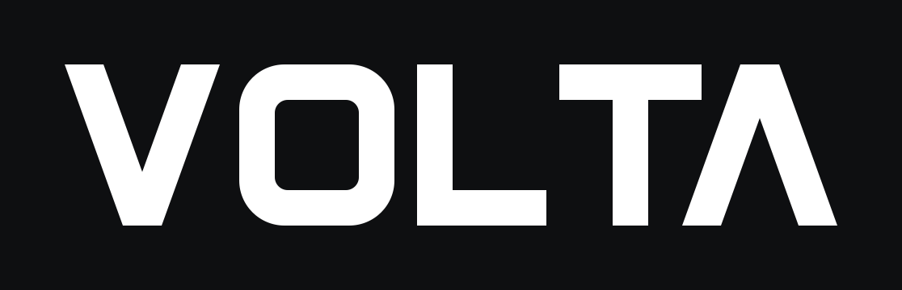
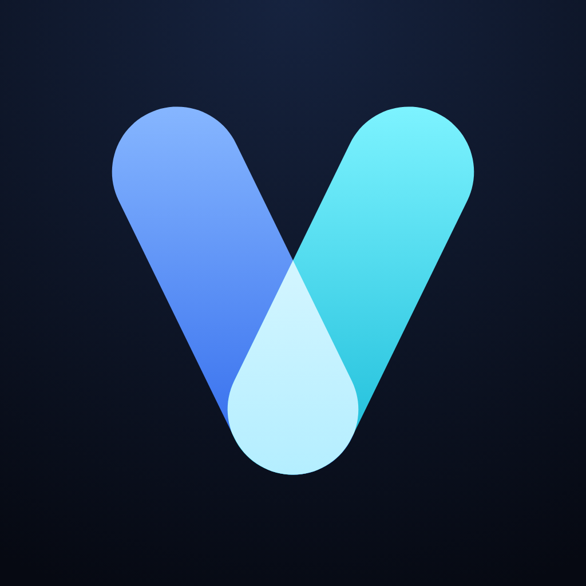

# Volta brand

Calm, dark, technical: white geometry on charcoal `#0E0F11`, with blue `#3B82F6`
as the only brand accent. Volta's marks are its own. Nothing here comes from
Wattly's logo or wordmark.

## Wordmark



- Source: [`wordmark.svg`](wordmark.svg), drawn from geometric shapes (no font dependency).
  The letters are 100 units tall with 22–24-unit stems, and the full mark has a 4.78:1 aspect ratio.
- The A has no crossbar. It mirrors the V, so the word opens and closes on the same chevron.
- In the app it's the `Wordmark` image set, an SVG with preserved vector data and
  template rendering. Tint it with `foregroundStyle`:

```swift
Image("Wordmark")
    .resizable()
    .scaledToFit()
    .frame(height: 20)            // width follows (≈ 96pt at 20pt tall)
    .foregroundStyle(.white)
    .accessibilityLabel("Volta")
```

## App icon



Two currents meet. A blue bar and a cyan bar lean together into a V, and the
shape where they cross is the brightest thing on the icon. Blue is the app's
battery and range colour; the V is the wordmark's first letter.

- Field: radial `#16233F` (top centre) to `#060912`.
- Bars: two 228 × 690 capsules tilted 26° either way on a 1024 canvas.
  Left `#86B6FF` to `#2F69EC`, right `#7DF3FF` to `#19BBD8`, crossing `#EAFBFF` to `#B4EEFF`.
- No glow, blur or highlight is drawn in. iOS 26 lights the layers itself, and
  painted effects turn muddy in the tinted and clear appearances.
- Green is absent on purpose: in the app it means charging and efficient.

| File | Appearance | Notes |
|---|---|---|
| `AppIcon.icon` | iOS 26 layered | Icon Composer file: crossing, right bar, left bar over the field gradient |
| `AppIcon.png` | Any / light | Opaque, no alpha |
| `AppIcon-Dark.png` | Dark | Transparent field, so the system supplies the dark backdrop |
| `AppIcon-Tinted.png` | Tinted | Opaque grayscale on black; the system maps luminance to the user's tint |

Every file comes from one script, so the geometry cannot drift between them:

```sh
python3 docs/brand/tools/make_icon.py
```

It writes `app-icon/icon{,-dark,-tinted}.svg`, the three layer SVGs and
`icon.json` inside `ios/Volta/Resources/AppIcon.icon/`, and renders the three
catalog PNGs with headless Google Chrome.

## Colors

| Asset | Value | Use |
|---|---|---|
| `AccentColor` | `#3B82F6` | App tint (SPEC blue). Wired through `NSAccentColorName` |
| `LaunchBackground` | `#0E0F11` | Launch screen background (SPEC charcoal) |

Wiring for the frame owner (`ios/project.yml` / Info.plist):

```yaml
settings:
  ASSETCATALOG_COMPILER_APPICON_NAME: AppIcon
  ASSETCATALOG_COMPILER_GLOBAL_ACCENT_COLOR_NAME: AccentColor
info:
  properties:
    UILaunchScreen:
      UIColorName: LaunchBackground
```

## Rendering

The wordmark preview comes from its SVG source via AppKit's native SVG loader:

```sh
swift docs/brand/tools/render.swift in.svg out.png 1024 [opaque]
```

The app icon PNGs come from `make_icon.py` above.
